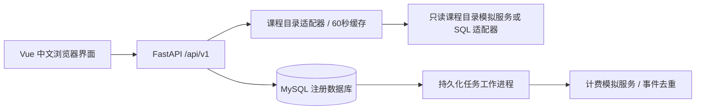
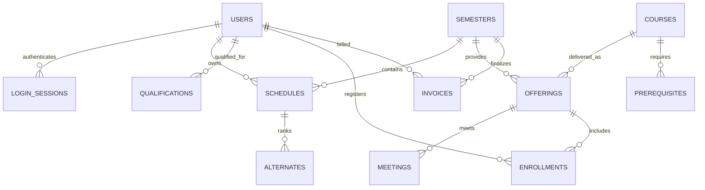

# 设计说明

## 系统边界

浏览器通过同源 `/api/v1` 接口访问 FastAPI。核心注册数据在 MySQL 8.0/InnoDB 中；Python 进程只持有项目最小权限账户。课程目录服务和计费服务是独立进程，计费发送由独立工作进程负责。三个界面共用会话服务，但每个接口重新校验角色和对象归属。



## 模型与历史保留

账户与人员资料合并在 `users` 中，角色明确限制为学生、教授或教务。身份号码用 Fernet 认证加密存储，另存带密钥的 HMAC 用于重复检测；接口只返回末四位脱敏结果。用户删除表现为停用，不物理删除历史学期的关联数据。



`Schedule.draft` 是独立草稿，`Enrollment` 是正式注册结果，`Alternate.position` 保存备选优先顺序。课程与教学班分离，同一课程可以在不同学期或不同班次开设。`Enrollment.grade_version` 和 `Schedule.version` 防止覆盖其他页面的修改。账单有学生、学期联合唯一约束；发送任务用 UUID 标识事件。

## 选课事务

首次正式提交必须有 4 个首选、2 个备选；以后可以有 1～4 个首选、0～2 个备选。删除课表保留首次提交时间，所以曾提交过的学生重建课表仍按调整规则处理。草稿允许不选满，也允许保留满员、先修不足或时间冲突的组合供调整，但不能引用无效教学班或重复课程。

正式提交顺序：学期共享锁 → 当前用户排他锁 → 课表排他锁 → 按编号升序锁住旧、新首选及备选的教学班。幂等请求在学期和用户锁之后才插入幂等记录，避免外键共享锁升级产生死锁。每班的 10 人容量检查与计数变更在同一事务内完成。

新选或退课后重新加入的教学班通过先修检查，全部首选通过教学班状态、时间和人数检查后，才替换旧正式关系。保留的已注册教学班不重复检查先修，符合原题第 14 页对尚未注册课程的检查规则。先修以此前已结束学期的 A～D 为通过；F、I、空成绩都不通过。时间检查同时考虑星期、周次交集以及时间区间，紧邻但不重叠的课可同时选择。备选不提前占座，也不要求备选之间互不冲突；实际补位时会再次检查。

草稿只锁学期、账户与自己的课表，不锁住名额、不更改正式选课。保存草稿增加课表版本，其他已打开页面必须刷新后继续修改。

## 结束选课

教务对学期取 `FOR UPDATE NOWAIT`。正在进行的选课、保存草稿、任课安排或相关人员操作会持有学期共享锁，此时结束操作立即返回 `RESOURCE_BUSY`，不等待业务操作完成。

处理顺序固定：取消没有有效教授的班 → 按首次提交时间及学生编号处理备选，最多补至 4 门 → 取消仍不足 3 人的班 → 固化课表、生成账单和发送任务 → 标记学期已关闭。最后一次人数取消后不再重复补位。任一步异常都回滚整个事务。

结束操作与正式提交均要求 `Idempotency-Key`。相同账户、操作、键和请求体返回原结果；同键换请求体报错。关闭成功的结果也可再次取回，不会重复开账单。

## 教授与教务

教授只可认领具备资格、尚无其他教授负责的教学班。修改时提交原教学班集合，服务器在账户锁内比较，并检查所有新安排的时间冲突。教授只能读取自己的名单，只能给自己已结束且正常开班的教学班录入 A/B/C/D/F/I 或空成绩。批量成绩更新中一条失败，全部回滚。

教务可新增、修改、停用学生与教授、维护任课资格、重置随机初始密码、维护选课开放时间、结束选课。停用学生释放开放学期名额并清理草稿与备选；停用教授撤销开放学期任课；两者立即撤销会话，已结束学期的成绩、账单与教授归属保留。正在使用的任课资格不能直接删除。

## 安全控制与接口约定

- Argon2id 密码哈希；初始化和重置生成随机密码，首次使用强制修改。
- 随机服务端会话；数据库只存会话令牌摘要，Cookie 为 HttpOnly、SameSite=Strict。空闲 30 分钟、绝对 8 小时失效。
- 修改操作同时校验 Origin、JSON Content-Type 和会话 CSRF 令牌。请求体限制为 64 KiB。
- 学生 API 由会话决定本人编号，教授名单与成绩 API 在服务器校验教学班归属。用户提交的额外身份字段被拒绝。
- 登录错误不区分账号不存在与密码错误；数据库中保存匿名摘要限流计数，账号 15 分钟最多 5 次连续失败，来源 15 分钟最多 60 次尝试。
- 数据库参数化查询、Pydantic 白名单字段、前端文本转义、CSP、点击劫持防护、敏感 API 禁用缓存。
- 业务错误统一返回 `code/message/details/request_id`；日志和审计不记录密码、会话令牌、完整身份号码或上游响应正文。

示例：

```json
{"code":"COURSE_FULL","message":"教学班已满，请调整选课","details":{"offering_id":11},"request_id":"服务器生成的请求编号"}
```

## 外部系统边界

未启用文件目录时，模拟目录的数据由初始化导入，目录读取刷新名称、院系和描述等展示元数据，注册系统不向外部目录写入。管理员现在可上传 JSON 外部目录，在一个事务中增加课程、教学班、先修关系和课时，并保存原始文件对象与合并目录至 `file_catalog`。导入后查询优先读取该持久快照，使用共享数据库版本使多个 API 工作进程及时更新缓存。相同代码和相同内容跳过，不同内容整批拒绝；不改写已存在的学期结构、任课关系或选课人数。导入按学期编号顺序取得 NOWAIT 排他锁，与选课及结束流程互斥。真实 Ingres 接入仍需驱动和实际环境联调。

HTTP 目录读取受 7.5 秒总期限限制；SQL 适配使用独立只读连接及驱动超时。缓存有效期默认 60 秒，过期后目录故障会终止查询、草稿、提交和任课选择，不无限使用过期数据。已保存课表、成绩和最终账单仍可读取。

正式提交只发送 `RegistrationUpdated` 通知，结束选课才发送 `InvoiceFinalized`。发送任务与本地业务事务一起提交；工作进程在短事务中认领任务、事务外调用计费、再确认结果。失败退避为 5/10/20/40/80/160/300 秒，之后保持 300 秒持续重试。任务租约 30 秒，进程中断后其他工作进程可继续处理。计费按事件编号检查内容一致性，最终账单再按学生、学期去重。
