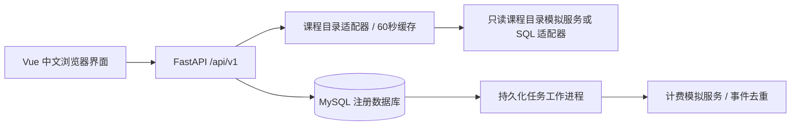
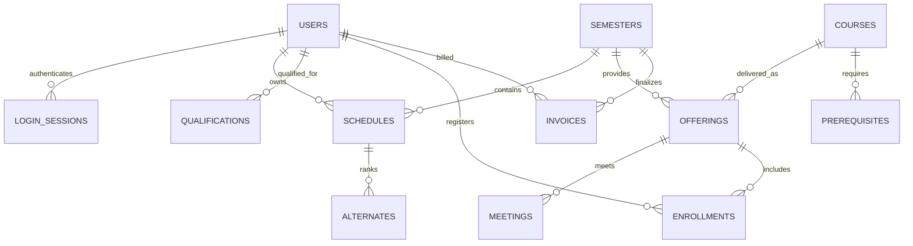

# 设计说明

## 系统边界

浏览器通过同源 `/api/v1` 接口访问 FastAPI。核心注册数据在 MySQL 8.0/InnoDB 中；Python 进程只持有项目最小权限账户。课程目录服务和计费服务是独立进程，计费发送由独立工作进程负责。三个界面共用会话服务，但每个接口重新校验角色和对象归属。



## 模型与历史保留

账户与人员资料合并在 `users` 中，角色明确限制为学生、教授或教务。身份号码用 Fernet 认证加密存储，另存带密钥的 HMAC 用于重复检测；接口只返回末四位脱敏结果。用户删除表现为停用，不物理删除历史学期的关联数据。



`Schedule.draft` 是独立草稿，`Enrollment` 是正式注册结果，`Alternate.position` 保存备选优先顺序。课程与教学班分离，同一课程可以在不同学期或不同班次开设。`Enrollment.grade_version` 和 `Schedule.version` 防止覆盖其他页面的修改。账单有学生、学期联合唯一约束；发送任务用 UUID 标识事件。

## 选课事务

首次正式提交必须有 4 个首选、2 个备选；以后可以有 1～4 个首选、0～2 个备选。删除课表保留首次提交时间，所以曾提交过的学生重建课表仍按调整规则处理。草稿允许不选满，也允许保留满员、先修不足或时间冲突的组合供调整，但不能引用无效教学班或重复课程。

正式提交顺序：学期共享锁 → 当前用户排他锁 → 课表排他锁 → 按编号升序锁住旧、新首选及备选的教学班。幂等请求在学期和用户锁之后才插入幂等记录，避免外键共享锁升级产生死锁。每班的 10 人容量检查与计数变更在同一事务内完成。

新选或退课后重新加入的教学班通过先修检查，全部首选通过教学班状态、时间和人数检查后，才替换旧正式关系。保留的已注册教学班不重复检查先修，符合原题第 14 页对尚未注册课程的检查规则。先修以此前已结束学期的 A～D 为通过；F、I、空成绩都不通过。时间检查同时考虑星期、周次交集以及时间区间，紧邻但不重叠的课可同时选择。备选不提前占座，也不要求备选之间互不冲突；实际补位时会再次检查。

草稿只锁学期、账户与自己的课表，不锁住名额、不更改正式选课。保存草稿增加课表版本，其他已打开页面必须刷新后继续修改。

## 结束选课

教务对学期取 `FOR UPDATE NOWAIT`。正在进行的选课、保存草稿、任课安排或相关人员操作会持有学期共享锁，此时结束操作立即返回 `RESOURCE_BUSY`，不等待业务操作完成。

处理顺序固定：取消没有有效教授的班 → 按首次提交时间及学生编号处理备选，最多补至 4 门 → 取消仍不足 3 人的班 → 固化课表、生成账单和发送任务 → 标记学期已关闭。最后一次人数取消后不再重复补位。任一步异常都回滚整个事务。

结束操作与正式提交均要求 `Idempotency-Key`。相同账户、操作、键和请求体返回原结果；同键换请求体报错。关闭成功的结果也可再次取回，不会重复开账单。

## 重新开启选课（扩展功能）

管理员调用 `POST /api/v1/registrar/semesters/{id}/reopen`，提交版本、带时区的开放起止时间和 `Idempotency-Key`。只允许对选课已关闭、学期尚未结束且没有已录入成绩的学期操作。截止时间须晚于现在，并不得超出学期结束日期。操作获取学期排他非等待锁，繁忙时立即返回可重试错误；人员修改也锁定关闭的学期，防止与重新开启交错。

重新开启保留有效正式选课与首次提交次序，将教学班恢复为 OPEN；原取消的选课不会自动恢复。已转为正式选课的备选从备选列表移除。关闭期间被停用的教授取消任课，被停用的学生释放名额；已结束历史学期不变。所有本学期课表增加版本、清空草稿，防止旧页面覆盖。原结束摘要记录在审计中。

本地账单增加 `status`（ACTIVE/VOIDED）与 `revision`。重新开启将原账单作废，并在同一事务写入 `InvoiceVoided`；再次结束选课更新原学生、学期唯一账单并发送新 `InvoiceFinalized`。版本取每次学期状态变更后的学期版本，严格递增。发送任务保留历史，接收方仍按事件编号去重，同时仅接受比现有账单更新的版本；较旧事件确认接收但不覆盖，同版本不同内容拒绝。作废事件可先于旧正式账单到达，也能阻止旧账单重新生效。旧协议中没有 revision 的事件按版本 0 处理。

本地账单变更与计费服务同步之间允许短暂延迟，故障时通过原持久化任务持续重试；计费任务中心单独显示“账单作废通知”。该行为已由本地计费模拟服务实现，真实计费系统接入时需支持作废与版本更新协议，不能将其视为真实资金退款实现。

## 教授与教务

教授只可认领具备资格、尚无其他教授负责的教学班。修改时提交原教学班集合，服务器在账户锁内比较，并检查所有新安排的时间冲突。教授只能读取自己的名单，只能给自己已结束且正常开班的教学班录入 A/B/C/D/F/I 或空成绩。批量成绩更新中一条失败，全部回滚。

教务可新增、修改、停用和恢复学生与教授账号、维护任课资格、重置随机初始密码、维护选课开放时间、结束选课。停用学生释放开放学期名额并清理草稿与备选；停用教授撤销开放学期任课；两者立即撤销会话，已结束学期的成绩、账单与教授归属保留。正在使用的任课资格不能直接删除。

恢复账号使用 `POST /api/v1/registrar/people/{user_id}/reactivate`，只允许管理员操作学生或教授，请求须携带当前 `version` 并通过 CSRF 与 Origin 检查。事务按学期共享锁、目标用户排他锁顺序执行，与停用、重新开启选课保持一致；版本不符或账号已经启用时返回具体错误。恢复仅设置 `active=true`、递增版本、清理目标账号的失败登录计数及残留会话，并写入 `REACTIVATE_PERSON` 审计；来源地址的限流仍然有效，任一环节失败全部回滚。密码、首次改密要求、身份资料和历史业务数据不变。已释放的选课与任课由用户重新提交并遵守名额、先修课、任课资格和时间冲突校验，不自动恢复；已失效会话不能重新获得访问权限。

## 个人课程状态与同步

学生 `GET /student/registration-status/{semester_id}` 在同一事务读取学期、本人正式课表、草稿、选课状态与该学期账单。教授 `GET /professor/teaching-status/{semester_id}` 返回本人的任课记录和有效教学班编号。两个接口均从登录身份确定人员编号，按学期共享锁、用户共享锁顺序读取；遇到正在处理的结束或个人变更事务立即返回可重试错误，防止在同一结果中混用变更前后的数据。状态查询读取本地业务记录，不依赖外部目录服务可用性。

`Enrollment.status_reason` 记录取消、退课的原因，重新开启学期清除教学班取消状态时仍保留个人取消原因；再次注册成功后清除旧原因。`teaching_assignments` 按教授、教学班保存认领及退出记录，退出任课后仍可查询；有效任课结果结合教学班当前状态计算，取消的教学班不进入授课时间表。迁移从已有任课安排、可恢复的操作审计补齐历史；没有记录的历史申请时间不作推测。

前端每 5 秒刷新，并在切换状态、课表和账单时立即读取。正式课表与账单使用同一个状态快照；课程目录仅提供课程与时间展示信息。学生费用页仅显示顶部所选学期，解释最终有效课程数与取消数。后台刷新保留开放期间尚未保存的编辑，同时保留编辑开始时的版本，防止使用旧选择覆盖另一个页面的最新提交；已结束选课则同步最终结果并明确提示未提交内容未生效。

## 教学结课与成绩录入

`Semester.state=CLOSED` 只表示选课已结束、名单已经固化，教学班的 `CLOSED` 对应“已确认开班”，不能直接解释为教学结束。管理员通过 `POST /api/v1/registrar/semesters/{id}/complete` 手动结课，须先结束选课，再提交当前版本与幂等键。接口取得学期排他 NOWAIT 锁，设置独立的 `completed_at`、递增版本并写入 `COMPLETE_SEMESTER` 审计。计划开始/结束日期、原名单、成绩、账单及计费版本均不修改，也不再次计费。失败全部回滚；重复请求重放原结果。迁移只增加可空字段，不推断或改写历史结课时间。

已手动结课，或选课已关闭且计划结束日期已经过去，统一视为教学完成。`academic.py` 为教师录入、学生成绩单、任课状态、重新开放限制和先修成绩判定提供同一标准；先修课按手动结课的实际日期或原计划结束日期判断，不再以未来的计划日期否定已经手动结课的成绩。结课后禁止重新开启选课。成绩写入按学期共享锁、教授账户排他锁、教学班锁顺序进行，与管理员结课/重新开放互斥，仍检查归属、学生名单、成绩枚举和逐条版本。

名单接口返回具体的成绩录入说明，分别解释尚未结束选课、已确认开班但未结课、已取消或可以录入。教授名单弹窗每 5 秒检测录入权限变化，管理员结课后可直接解锁；已经进入编辑时只同步权限，不覆盖本地成绩及版本。学生默认成绩单选择最近实际结课的学期。此处的管理员手动结课是用户补充的操作流程，PDF 第 18 页规定已完成课程可提交成绩，但未规定管理员按钮形式。

## 安全控制与接口约定

- Argon2id 密码哈希；初始化和重置生成随机密码，首次使用强制修改。
- 随机服务端会话；数据库只存会话令牌摘要，Cookie 为 HttpOnly、SameSite=Strict。空闲 30 分钟、绝对 8 小时失效。
- 修改操作同时校验 Origin、JSON Content-Type 和会话 CSRF 令牌。请求体限制为 64 KiB。
- 学生 API 由会话决定本人编号，教授名单与成绩 API 在服务器校验教学班归属。用户提交的额外身份字段被拒绝。
- 登录错误不区分账号不存在与密码错误；数据库中保存匿名摘要限流计数，账号 15 分钟最多 5 次连续失败，来源 15 分钟最多 60 次尝试。
- 数据库参数化查询、Pydantic 白名单字段、前端文本转义、CSP、点击劫持防护、敏感 API 禁用缓存。
- 业务错误统一返回 `code/message/details/request_id`；日志和审计不记录密码、会话令牌、完整身份号码或上游响应正文。

示例：

```json
{"code":"COURSE_FULL","message":"教学班已满，请调整选课","details":{"offering_id":11},"request_id":"服务器生成的请求编号"}
```

## 外部系统边界

未启用文件目录时，模拟目录的数据由初始化导入，目录读取刷新名称、院系和描述等展示元数据，注册系统不向外部目录写入。管理员现在可上传 JSON 外部目录，在一个事务中增加课程、教学班、先修关系和课时，并保存原始文件对象与合并目录至 `file_catalog`。导入后查询优先读取该持久快照，使用共享数据库版本使多个 API 工作进程及时更新缓存。相同代码和相同内容跳过，不同内容整批拒绝；不改写已存在的学期结构、任课关系或选课人数。导入按学期编号顺序取得 NOWAIT 排他锁，与选课及结束流程互斥。真实 Ingres 接入仍需驱动和实际环境联调。

HTTP 目录读取受 7.5 秒总期限限制；SQL 适配使用独立只读连接及驱动超时。缓存有效期默认 60 秒，过期后目录故障会终止查询、草稿、提交和任课选择，不无限使用过期数据。已保存课表、成绩和最终账单仍可读取。

正式提交只发送 `RegistrationUpdated` 通知，结束选课才发送 `InvoiceFinalized`。发送任务与本地业务事务一起提交；工作进程在短事务中认领任务、事务外调用计费、再确认结果。失败退避为 5/10/20/40/80/160/300 秒，之后保持 300 秒持续重试。任务租约 30 秒，进程中断后其他工作进程可继续处理。计费按事件编号检查内容一致性，最终账单再按学生、学期去重。
